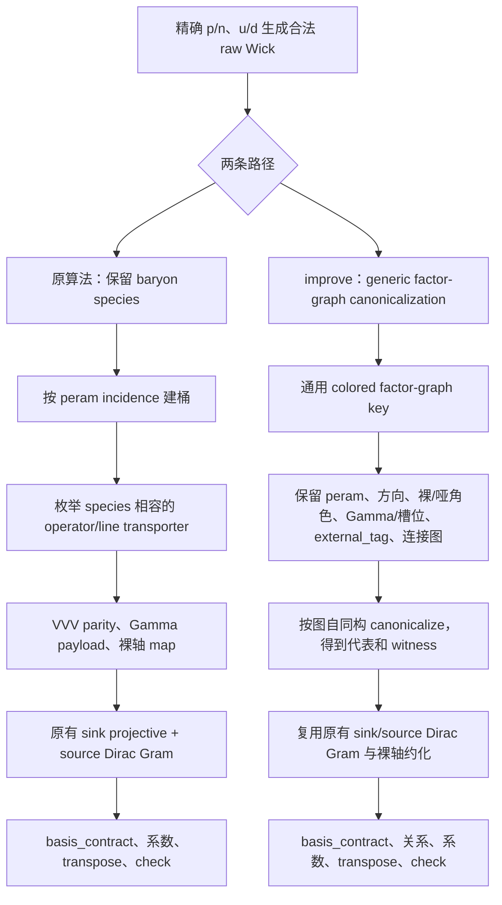

# 原算法与 improve 算法

两条路径都从精确的 p/n、u/d Wick 生成开始。区别发生在 raw Wick 已经生成以后：原算法把重子块标签保留在 transporter 的候选关系中；improve 算法通过 `reduce_operators()` 接受任意算符序列，并在 generic factor-graph policy 下把 hadron species 标签从 key 中去掉，只保留实际收缩需要的信息。

## 关键差别

| 项目 | 原算法 | improve 算法 |
| --- | --- | --- |
| hadron 标签 | 作为 operator transporter 的颜色保留 | generic factor-graph key 不使用 species；VVV/VDV、Gamma、动量标签和连接图仍保留 |
| 同位旋条件 | `isospin_degenerate=True` 只合并 u/d 的数值 peram 类 | 当前模型中 VVV 和 Gamma 与重子无关，因此同位旋特有的数值条件就是 `peram_u == peram_d`；动量、投影和 `external_tag` 若不同仍保留 |
| 约化对象 | 直接比较实际开放指标收缩张量 | 先合并 p/n 无关的连接图，再比较实际开放指标收缩张量 |
| 裸指标 | 用 `bare_axis_map` 记录重命名和 transpose | 完全复用原算法的 `bare_axis_map` 和 transpose |
| 剩余指标对称性 | transporter、VVV parity、sink rank、source Gram | 同一层逻辑原样保留；因子图 canonicalization 不是它的替代品 |
| 输出 | `basis_contract`、dependent relation、`check` | 相同输出结构，额外保存 factor-graph canonicalization witness |

`reduce_operators()` 始终使用同一条 generic factor-graph 路径，因为它约化的是
peram、VVV/VDV、Gamma、动量标签和连接图，而不是粒子名字；不存在第二条
species-aware 约化路径。

## 为什么不是 576 次 p/n transporter

把四个 p/n sink/source 块任意互换会产生一个很大的候选置换空间。improve 不逐项尝试这些 p/n 标签置换，而是直接把每个 raw Wick 写成带颜色的二部连接图，在保留的颜色和连接关系下求 canonical key。这个 canonicalization 是输入无关的：代码没有写死 ppnn 的“四个 sink、四个 source”数目；二部图的行列规范化只是一般图算法在该结构上的快速实现。

这一步只回答“两个 raw Wick 是否具有相同的 p/n 无关因子图”。它不单独证明开放自旋张量相等，所以随后仍必须运行原有的 VVV/Gamma、裸轴和 Dirac Gram 约化。

## 适用边界

当前 ppnn 夹具的 VVV、Gamma、动量和投影在 p/n 之间相同，且 u、d 使用同一个数值 peram，因此可以使用 p/n 无关的 factor-graph key。若 p/n 使用不同 momentum、`external_tag`、Clebsch 系数、额外相位或不同插值算符，相关标签会留在 key 中，算法自动退回较小的等价类；不能仅凭粒子名字相同而合并。

两条路径的共同不变量是：每个 raw Wick 恰好出现一次，费米符号只计算一次，裸轴置换和复系数附在 dependency relation 上，最后都能通过 `check` 回代到 raw Wick。improve 改变的是候选等价类的入口，不改变原 reducer 负责的线性张量约化。
